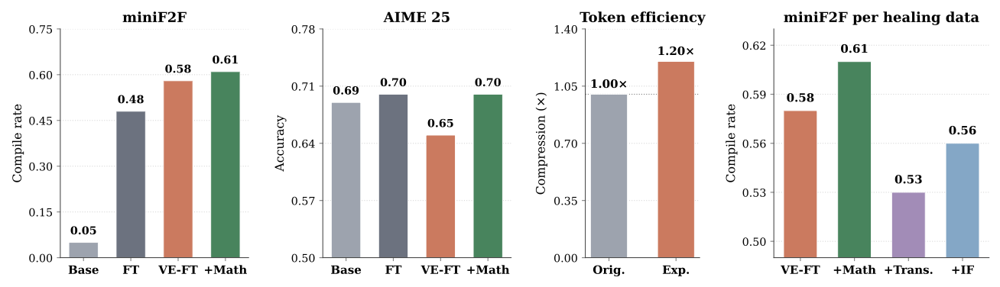
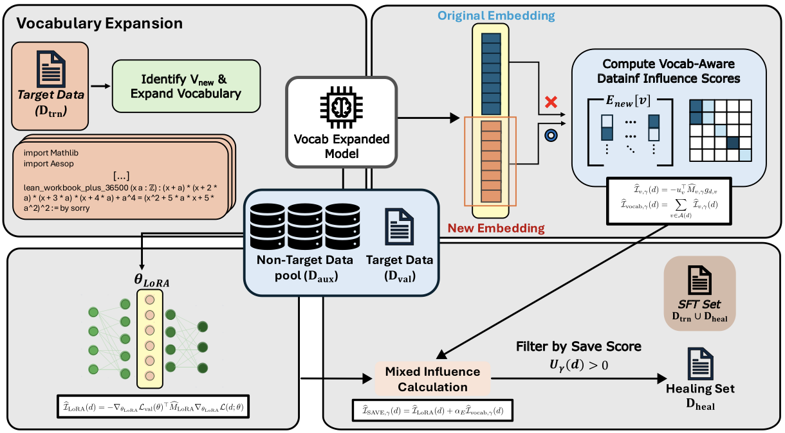

<div align="center">

# SAVE: Sparsity-Aware Influence Estimation for Vocabulary-Expanded LLMs

**Seungyoo Lee**<sup>1</sup> · **Giung Nam**<sup>1</sup> · **Seanie Lee**<sup>2</sup> · **Hyungi Lee**<sup>3†</sup> · **Juho Lee**<sup>1†</sup>

<sup>1</sup>KAIST &nbsp;&nbsp; <sup>2</sup>Apple &nbsp;&nbsp; <sup>3</sup>Kookmin University &nbsp;&nbsp; <sup>†</sup>Corresponding authors

**NeurIPS 2026**


</div>

---

> [!NOTE]
> **🚧 This repository is a placeholder. The code is being turned into a library.**
>
> We are refactoring our research code into a modular, reusable Python library. The official
> implementation will be released here step by step; see the [Release Plan](#-release-plan).
> Star or watch this repository to get notified when it is released.

---

## 📌 TL;DR

Extending an LLM's tokenizer with target-specific tokens (e.g. `Mathlib`, `linarith`, tool-call markers)
helps on specialized targets. However, the **new embedding rows receive gradients only from examples that contain those
tokens**. After target-only fine-tuning they are **transfer-incomplete**: they help on the target benchmark but
are not integrated with related capabilities.

**SAVE** (**S**parsity-**A**ware **V**ocabulary **E**stimator) automatically selects *healing data*
from a generic corpus. It uses an influence estimator that accounts for the **row-sparse gradients** of the new
embedding rows and combines it with a dense LoRA-level influence.

## 📝 Abstract

Large language models adapted to specialized targets such as Lean theorem proving or tool calling often benefit
from extending the tokenizer with target-specific tokens. However, target-only vocabulary-expanded fine-tuning can
leave the newly added embeddings transfer-incomplete, since the new rows receive gradients only from examples
containing the corresponding tokens, so target-local gains do not necessarily imply that the embeddings are
integrated with related capabilities. We propose SAVE, a sparsity-aware influence estimator for selecting auxiliary
healing data from generic corpora. SAVE computes token-conditional curvature over the effective update set of each
new vocabulary row and combines this vocabulary-aware signal with dense LoRA-level influence. Across Lean
autoformalization and tool calling, SAVE improves target performance and related transfer while remaining
competitive on broad retention benchmarks, and its gains carry over to a smaller backbone and a less syntactically
rigid medical target.

## 🔍 Motivation: Transfer-Incomplete Vocabulary Expansion

<p align="center">
  
</p>

Vocabulary-expanded fine-tuning (**VE-FT**) improves the target miniF2F benchmark and token efficiency (1.20×
compression). However, it **hurts related AIME-style mathematical reasoning** compared to standard fine-tuning.
Adding *related* auxiliary data (math) recovers this drop and further improves miniF2F. *Less related* data
(translation, instruction following) hurts target performance. So **the choice of healing data matters**, and we want
to select it automatically.

## 💡 Method

<p align="center">
  
</p>

Given target training data $\mathcal{D}_{trn}$, SAVE works in three steps:

1. **Vocabulary expansion.** Frequent target-domain strings that the base tokenizer fragments become new tokens
   $\mathcal{V}_{new}$. Their embeddings are initialized as an exponentially weighted sum of their sub-token embeddings.
2. **Influence scoring.** The vocabulary-expanded model is used as a surrogate. SAVE scores every auxiliary candidate
   $d \in \mathcal{D}_{aux}$ against the target validation set $\mathcal{D}_{val}$ using two terms.
3. **Healing.** SAVE keeps the positive-utility examples, takes the top-ranked ones under a budget as
   $\mathcal{D}_{heal}$, and fine-tunes on $\mathcal{D}_{trn} \cup \mathcal{D}_{heal}$ with source-balanced mini-batches.

### Vocabulary-aware influence (token-conditional curvature)

The embedding row $e_v$ of a new token $v$ gets a nonzero gradient only on its *effective update set*
$S_v = \lbrace d : g_{d,v} \neq 0 \rbrace$, with $n_v = |S_v|$ and $p_v = n_v / |\mathcal{D}_{aux}|$. Standard
full-corpus normalization scales the token curvature by $p_v$, so rare tokens get swamped by the damping term.
SAVE instead estimates the curvature **only over $S_v$**:

$$
\widehat{M}_{v,\gamma} = \frac{1}{n_v}\sum_{d \in S_v}\left(p_v^{\gamma}\, g_{d,v} g_{d,v}^\top + \lambda_v I\right)^{-1},
\qquad
\widehat{\mathcal{I}}_{vocab,\gamma}(d) = \sum_{v \in A(d)} -u_v^\top \widehat{M}_{v,\gamma}\, g_{d,v}
$$

Here $\gamma = 0$ is fully token-conditional and $\gamma = 1$ recovers full-corpus scaling.

### Mixed influence score

$$
\widehat{\mathcal{I}}_{SAVE,\gamma}(d) = \widehat{\mathcal{I}}_{LoRA}(d) + \alpha_E\, \widehat{\mathcal{I}}_{vocab,\gamma}(d),
\qquad U_\gamma(d) = -\widehat{\mathcal{I}}_{SAVE,\gamma}(d)
$$

The LoRA-level DataInf term captures **content-level transfer**, and the vocabulary term captures
**target-vocabulary alignment**. The vocabulary term is a modular plug-in: it also improves **LESS**, **OGS**, and **DataInf**.

## 📊 Main Results

### Lean autoformalization (Qwen3-8B)

| Setting | miniF2F Compile | miniF2F Acc. | AIME 2025 | MMLU-Pro | LCB v1-5 | IF-Eval | Retention Avg. |
|---|:-:|:-:|:-:|:-:|:-:|:-:|:-:|
| Target-only | 0.6803 | 0.5861 | 0.7104 | 0.7057 | 0.5123 | 0.7819 | 0.6666 |
| Target + Random | 0.6516 | 0.5205 | 0.7068 | 0.7093 | 0.5188 | 0.8272 | 0.6851 |
| Target + All-Inst | 0.7049 | 0.6434 | 0.7130 | 0.7198 | 0.5220 | 0.8341 | 0.6920 |
| Target + LESS | 0.6967 | 0.5984 | 0.7198 | 0.7121 | 0.5192 | 0.8049 | 0.6787 |
| Target + OGS | 0.7008 | 0.6107 | 0.7172 | 0.7273 | 0.5238 | 0.8314 | 0.6942 |
| Target + DataInf | 0.7172 | 0.6311 | 0.7203 | 0.7115 | 0.5343 | 0.8252 | 0.6903 |
| **Target + SAVE (ours)** | **0.7909** | **0.7213** | **0.7328** | 0.7129 | 0.5468 | 0.8194 | 0.6930 |

### Tool calling (ToolWeaver, Llama-3-8B), NDCG@k

| Model | I1 @1 | I1 @3 | I1 @5 | I2 @1 | I2 @3 | I2 @5 | I3 @1 | I3 @3 | I3 @5 |
|---|:-:|:-:|:-:|:-:|:-:|:-:|:-:|:-:|:-:|
| ToolGen | 88.50 | 88.83 | 91.65 | 84.00 | 85.65 | 89.02 | 81.00 | 80.83 | 85.83 |
| ToolWeaver | 91.16 | 91.14 | 93.48 | 89.76 | 89.70 | 91.80 | 88.00 | 85.80 | 90.12 |
| ToolWeaver + SAVE (Fixed-Budget) | 92.43 | 92.31 | 94.68 | 91.38 | 91.05 | 93.24 | 90.00 | 87.18 | 91.32 |
| **ToolWeaver + SAVE (ours)** | **93.45** | **93.07** | **95.62** | **93.18** | **92.91** | **94.46** | **92.00** | **89.27** | **93.23** |

### Generalization: smaller backbone and a medical target

| Qwen3-4B (autoformalization) | Compile | Acc. | AIME 25 |
|---|:-:|:-:|:-:|
| Target-only | 0.5861 | 0.5041 | 0.6276 |
| DataInf | 0.6230 | 0.5287 | 0.6385 |
| **SAVE (ours)** | **0.6721** | **0.5820** | **0.6547** |

| Llama-3.1-8B-Instruct (MedQA) | Accuracy |
|---|:-:|
| Base model | 0.6135 |
| Target-only | 0.7203 |
| DataInf | 0.7502 |
| **SAVE (ours)** | **0.7926** |

## 🗺️ Release Plan

The code is being refactored into a modular library. Planned components:

| Module | Description | Status |
|---|---|:-:|
| `save.vocab` | Target-vocabulary mining (frequency × savings) and exponential embedding initialization | 🚧 |
| `save.gradients` | Per-example gradient extraction for LoRA blocks and new embedding rows | 🚧 |
| `save.influence` | DataInf LoRA influence, token-conditional vocabulary influence, and the mixed SAVE score | 🚧 |
| `save.selection` | Positive-utility filtering and budgeted healing-set selection | 🚧 |
| `save.training` | Final SFT with source-balanced mini-batches | 🚧 |
| `save.eval` | miniF2F, AIME 2025, MMLU-Pro, LiveCodeBench, IF-Eval, ToolBench, MedQA | 🚧 |
| Baselines | LESS, OGS, EmbSim, New-token TF-IDF | 🚧 |
| Artifacts | Expanded tokenizers, selected healing sets, checkpoints | 🚧 |

## 📖 Citation

If you find this work useful, please cite:

```bibtex
@inproceedings{lee2026save,
  title     = {{SAVE}: Sparsity-Aware Influence Estimation for Vocabulary-Expanded {LLMs}},
  author    = {Lee, Seungyoo and Nam, Giung and Lee, Seanie and Lee, Hyungi and Lee, Juho},
  booktitle = {Advances in Neural Information Processing Systems},
  year      = {2026}
}
```

## 📬 Contact

For questions, please open an issue or contact Seungyoo Lee (punctuate@kaist.ac.kr).
